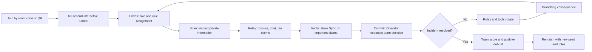
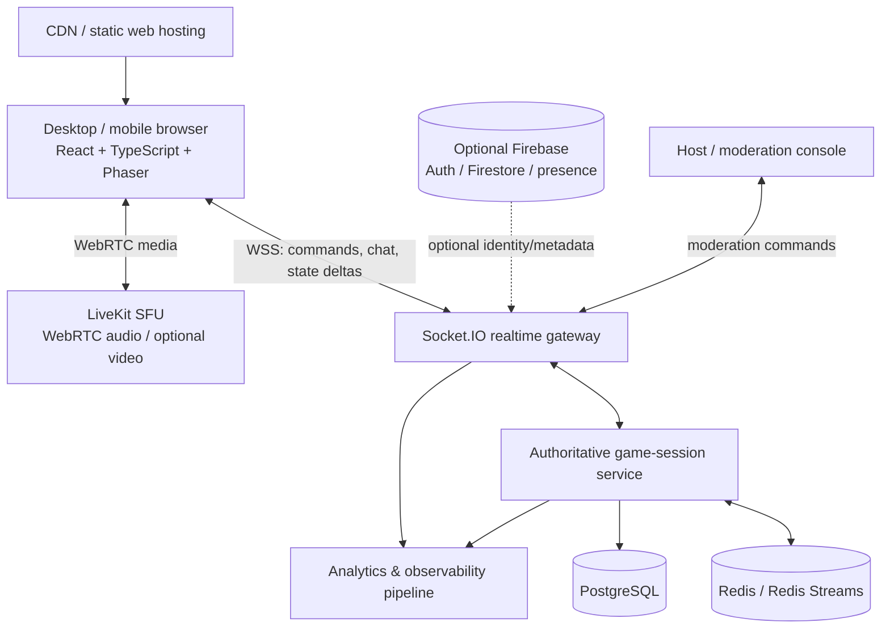

# Designing a Live Interactive Office Game: “Signal Shift”

## Executive summary

The strongest concept for the brief is **Signal Shift**, a browser-based, cooperative communication game for **5–15 office colleagues** in which every player holds a different fragment of a fictional incident, while the authority to inspect clues, verify claims and execute actions rotates around the group. Its distinctive combination is:

**fragmented information + rotating ownership + confidence staking + branching consequences**.

Rather than copying social deduction, trivia or drawing-party formats, Signal Shift makes *communication itself* the game. Players have to turn incomplete private information into a reliable shared mental model, while periodically losing their current role and handing it to somebody else. A lightweight “confidence market” lets players spend finite in-game **Sync tokens** to back important claims; correct claims create resources or score, while incorrect ones consume them. There is no real-money gambling and no player elimination.

This direction deliberately borrows proven interaction patterns without reproducing their core games. Jackbox demonstrates the value of browser/room-code joining and phones as controllers; *Keep Talking and Nobody Explodes* demonstrates the strength of asymmetric information and verbal co-operation; *Gartic Phone* demonstrates that a voice channel can complement structured browser actions; and *Among Us* demonstrates that an online party game can operate across a player range overlapping the requested 5–15 players. citeturn18search0turn18search2turn18search3turn18search1

**Recommended product shape**

| Decision | Recommendation |
|---|---|
| Audience | Office colleagues with mixed gaming ability, seniority, personality and professional/casual expectations |
| Players | 5–15; 5–10 in one group, 11–15 divided dynamically into communication “pods” |
| Default session | **20–25 minutes** |
| Other modes | 10–12-minute Quick Shift; 35–45-minute Deep Shift |
| Platform | Web-first responsive application; desktop and mobile browsers; optional PWA installation |
| Interaction | **Voice-first, text/reactions always available, video optional and off by default** |
| Competitive model | Primarily co-operative team score; optional team-v-team mode later |
| Elimination | None |
| Recommended engine | React + TypeScript for product UI; Phaser for shared 2D game surfaces |
| Game networking | Authoritative Node.js/TypeScript service using Socket.IO |
| Voice/video | WebRTC through a managed SFU, preferably LiveKit |
| Fast state | Redis/Redis Streams |
| Durable data | PostgreSQL; Firestore is a credible managed alternative for accounts/content/metadata |
| MVP planning estimate | 8–10 weeks |
| Beta | another 6–8 weeks |
| Full release | another 8–12 weeks; approximately **22–30 weeks total** |
| Business model | Host/team subscription; guests join free; enterprise organisation tier |
| Strategic differentiator | A party game about **clear collaboration under changing information**, rather than trivia knowledge, drawing skill or deception |

The recommended technology deliberately separates **media transport** from **authoritative game state**. Browser WebRTC exposes media through `getUserMedia()` and `RTCPeerConnection`, but straightforward peer-to-peer WebRTC does not scale elegantly to a 15-person room. LiveKit documents that P2P works well for roughly two or three peers and uses an SFU architecture for larger groups. citeturn16search1turn16search4turn15search9 Socket.IO is well suited to low-latency game commands and room-level broadcasts, but its default delivery semantics are at-most-once even though ordering is guaranteed, so important actions should carry unique command IDs, acknowledgements and idempotency protection. citeturn17search9turn17search1

The development estimates in this report are **planning estimates**, assuming roughly two product/game engineers, one realtime/backend engineer, one game/product designer, and fractional UI/art/audio/QA capacity. They are not vendor estimates.

The word “unique” should be interpreted as **design-level differentiation**. The comparative research below indicates a materially different combination of mechanics from the sampled established games, but it is not a legal patent, copyright or trade-mark clearance search.

## Design brief and concept options

The office setting creates a different design problem from a conventional consumer multiplayer title. The game has to entertain people who may range from experienced gamers to colleagues who rarely play games, while avoiding mechanics that become uncomfortable when professional relationships and organisational hierarchy are involved.

That argues against four common failure modes: long mechanical tutorials, permanent elimination, games dominated by reaction speed, and compulsory deception or public humiliation. Social deduction can work brilliantly among friends, but making a junior employee repeatedly accuse or deceive a manager should not be the only route to fun. The better centre of gravity is **collective problem-solving with momentary individual responsibility**.

Established party titles suggest several useful patterns. Jackbox lets participants join from browser-capable devices with a room code and has also introduced QR-code joining, reducing installation friction. citeturn18search0turn18search11 *Keep Talking and Nobody Explodes* separates what one participant can see from what other participants know, making communication itself mechanically important. citeturn18search2 *Gartic Phone* alternates structured individual contributions and a shared reveal, while explicitly recommending a voice call. citeturn18search3 Signal Shift should combine those usability lessons while replacing drawing, trivia and hidden-traitor play with a communication-and-handoff system.

### Three distinct concept variants

| Variant | Core hybrid mechanic | Player scaling | Ideal length | Principal strengths | Principal disadvantages / risks | Complexity | Planning estimate | Ideal technology |
|---|---|---:|---:|---|---|---|---|---|
| **Signal Shift** — recommended | Asymmetric clues + rotating functional roles + confidence staking + branching incident | 5–10 one group; 11–15 in linked pods | 10–45 min; **20–25 ideal** | Inclusive, strongly social, little specialist game skill; produces memorable communication moments; highly themeable | Requires excellent scenario authoring; voice dynamics need careful facilitation; scoring must not reward loudness | Medium–high | MVP 8–10 weeks; polished product 22–28 | React/TS + Phaser + Socket.IO + LiveKit + Redis + PostgreSQL |
| **Pitch Circuit** | Collaborative idea-building + constraint drafting/trading + short pitches + peer evaluation | 5–15 naturally | 10–30 min | Lowest technical risk; creative; excellent for workshops/icebreakers; works even without game canvas | Can resemble “another work meeting”; extroverts may dominate live pitches; subjective voting can become popularity voting | Medium | MVP 6–8 weeks; polished product 14–18 | React/TS + Socket.IO; Phaser optional; WebRTC audio |
| **Parallel Lines** | Two or three linked worlds where actions in one alter rules/tiles in another + intermittent communication windows + role migration | Best at 8–15 | 20–45 min | Most game-like and visually distinctive; high replay value; strong teamwork puzzles | Hardest balancing/content problem; more screen space and mobile UX pressure; longer tutorial | High | MVP 12–16 weeks; polished product 26–36 | Phaser 4 or Unity Web + authoritative realtime server + WebRTC |

**Pitch Circuit** would give each group an unusual brief such as “design a hotel for time travellers”, then privately distribute customer needs, inconvenient constraints and limited “Influence” tokens. Teams assemble the concept while players rotate through Editor, Researcher and Presenter positions. Players can spend Influence to attach, reveal or exchange constraints before a 30-second pitch. Evaluation should score fit-to-brief and successful use of constraints rather than merely asking “which pitch do you like?”, reducing personality-based voting.

**Parallel Lines** would be the ambitious game-oriented option. Two or three teams see related 2D maps representing different timelines. A switch pressed in Timeline A might remove a wall in B but disable a bridge in C. Communication opens only during regular “signal windows”; between those windows each team must act on what it understood. One player changes timelines each act, physically carrying information and powers between groups. This provides very strong mechanical novelty but demands considerably more level design, rendering, synchronisation and playtesting.

Unity is technically viable for Parallel Lines: current Unity Web documentation supports browser-deployed real-time interactive content, mobile browser use and touch input, although browser networking has Web-platform constraints and Unity Transport uses WebSockets where direct UDP is unavailable to browser code. citeturn19search13turn19search0turn19search3turn19search1 For Signal Shift, however, a web-native product shell plus Phaser is the better fit. Phaser is explicitly an HTML5 framework using WebGL/Canvas across desktop and mobile browsers. citeturn15search3

The recommendation is therefore **Signal Shift first**, with Pitch Circuit potentially becoming a later low-complexity game mode sharing the same lobby, media and realtime infrastructure. Parallel Lines is better treated as a second-generation title once the multiplayer platform has proven itself.

## Recommended game design: Signal Shift

**Working premise.** A team is responsible for stabilising a deliberately fictional, slightly absurd situation: for example, an orbital hotel preparing for its opening ceremony, a museum in which historical eras are leaking into one another, or a lunar food festival whose automated systems have begun interpreting menus as engineering instructions. Keeping the fiction playful is important; recreating authentic corporate incidents too closely risks making the event feel like mandatory training.

Every player can see the **shared situation board**, but each also has private information and a private capability. No player has enough information or permissions to solve the incident alone.

A typical act uses this loop:



**Fragmented truth.** Different people might see:

- a subsystem map;
- a rule such as “blue routes invert after an overload”;
- the meaning of three otherwise cryptic symbols;
- a log showing what changed in the last incident;
- one control panel containing the actual action buttons.

Those fragments are generated so that any meaningful decision requires information from several roles. The design should avoid “I have nothing useful this round” states.

**Rotating ownership** is the defining mechanic. Approximately every 90 seconds to three minutes, depending on session mode, the game moves capabilities rather than merely distributing new questions. The former Navigator may become the Auditor; the Operator may become the Decoder. Players therefore have to provide concise handovers rather than becoming permanent specialists.

This specifically addresses office-group dynamics: a knowledgeable or confident participant can help, but cannot monopolise all mechanically important controls for an entire session.

**Confidence staking** adds tension without requiring deception. The group has a limited pool of **Sync**. A player can mark a statement on the shared board and stake one to three Sync on it:

> “Gate C is safe after the yellow cycle.”

Another player can verify, challenge or attach evidence. Once the game state proves the claim right or wrong, the stake either grows the team resource or costs it.

The important design choice is that a “claim” is a structured game object, not merely arbitrary chat. It records the claim category, author, attached evidence, confidence and eventual result. This creates measurable communication gameplay while avoiding a score based on who speaks most.

**Branching incidents** make decisions consequential. A team that reroutes power to the observatory may later receive a navigation advantage but lose a repair station. The branch tree should be shallow enough to author reliably but broad enough that colleagues cannot memorise one perfect script after playing twice.

### Roles and scaling

| Role | Private capability | Why the role matters |
|---|---|---|
| **Navigator** | Sees connections, topology or spatial dependencies hidden from others | Converts scattered facts into a route or sequence |
| **Decoder** | Sees rules, legends, symbol meanings or transformation tables | Turns apparently meaningless information into usable facts |
| **Operator** | Holds the controls that actually commit game-state changes | Forces the group to communicate before action |
| **Auditor** | Can verify a limited number of claims or compare current and prior states | Rewards careful checking rather than impulsive consensus |
| **Dispatcher** | Can transmit scarce clues, unlock cross-pod communication or move a resource | Becomes the communication bridge |

At **five players**, every core role appears once.

At **six to ten**, extra specialist roles such as Archivist or Scout can appear, or two players can receive partially overlapping information.

At **eleven to fifteen**, the room should automatically form two or three **pods** solving connected subsystems. One or two rotating Dispatchers can see dependencies between pods. This prevents a 15-person voice channel from becoming the equivalent of an uncontrolled conference call.

Team formation should be automatic by default, using randomised or deliberately balanced role history, with a host override. In later enterprise versions, avoid using job title, organisational seniority or HR attributes for automatic balancing unless the organisation has explicitly opted into such processing.

### Session-length modes

| Mode | Length | Structure | Best use |
|---|---:|---|---|
| **Quick Shift** | 10–12 min | Tutorial skipped after first play; one major incident, two role handovers | Meeting opener, coffee break, recurring weekly game |
| **Standard Shift** | **20–25 min** | Three acts, branching middle act, finale | Recommended default |
| **Deep Shift** | 35–45 min | Four–five acts, multiple pods, more difficult cross-dependencies, finale | Team socials, dedicated game session |

The standard mode is the best launch configuration: long enough for role rotation to become meaningful, but short enough to fit inside a common 30-minute calendar slot with joining and debriefing.

### Win conditions and scoring

The **primary win condition** is collective: resolve the final incident while the Stability meter remains above zero. Certain bad decisions reduce Stability; some optional objectives recover it. A failed mission still reaches a debrief and receives a partial score rather than abruptly ending.

A proposed 1,000-point score is:

| Component | Points | Design intent |
|---|---:|---|
| Correct objectives and final solution | 450 | Accuracy matters most |
| Time/resource efficiency | 200 | Adds urgency without making raw speed dominant |
| Correctly verified confidence claims | 150 | Rewards evidence-backed communication |
| Successful role handovers and information coverage | 100 | Encourages participation across the group |
| Optional objective / recovery performance | 100 | Gives strong teams additional mastery goals |

**Do not score speaking time, message count, camera activity or reaction speed as “participation”.** Those metrics would systematically favour some communication styles and penalise quiet players, hearing/speech differences, non-native speakers or people joining from less favourable network environments.

The score should be **team-first**. Individual end screens can recognise positive contributions such as “Three useful verifications”, “Cleanest handoff” or “Caught the critical contradiction”, but avoid a permanent office leaderboard that labels someone “worst player”.

### Progression and replayability

Within a session, good play fills a shared Sync meter and unlocks single-use team powers such as:

**Second Scan** reveals one extra clue; **Hold the Line** delays a role rotation; **Open Channel** lets two pods communicate early; **Rollback** previews the consequence of an action without committing it.

Persistent progression should be primarily **horizontal**, not power-based. Players can earn role-card cosmetics, avatar treatments, titles, scenario themes and access to harder incident sets. A colleague who plays every week should not receive a permanent numerical advantage over someone invited for the first time.

Replayability comes from several interacting systems: procedural selection of vetted clue modules, role rotation, branch-dependent later rules, optional objectives, difficulty modifiers, different pod arrangements and deterministic random seeds. *Keep Talking and Nobody Explodes* similarly uses variation in puzzles to maintain repeated-play freshness, demonstrating the broader value of recombination in communication-centric play. citeturn18search2

For full release, build an internal **scenario-authoring tool** that represents a scenario as data rather than hard-coded logic:

```text
theme
  -> acts
      -> modules
          -> private clues
          -> dependency rules
          -> allowed actions
          -> validation rules
          -> consequences
          -> difficulty tags
```

That content pipeline is strategically more important to long-term replayability than adding more rendering technology.

## Interaction, accessibility, trust and social design

### Recommended real-time interaction model

The default should be **voice-first, text/reactions-always, video-optional**.

WebRTC is designed for browser real-time media: browsers can obtain microphone/camera media with `navigator.mediaDevices.getUserMedia()`, and media tracks can be sent over peer connections. citeturn16search4turn16search7 For a 5–15-person game, however, use an SFU rather than a full peer-to-peer mesh; LiveKit's own architecture documentation notes that plain P2P is most suitable for roughly two or three peers and that larger groups require a client-server model. citeturn15search9

Video should **not** be mechanically required. It adds little to Signal Shift's core information puzzle, creates extra visual distraction, consumes more media bandwidth and makes the product less comfortable for participants who do not want to appear on camera. The polished version can offer optional lobby/debrief video or a temporary “spotlight” view.

The application should adapt its media behaviour to context:

| Setting | Recommended media |
|---|---|
| Fully remote | In-game WebRTC voice + text + structured signal cards + reactions |
| Everyone in one physical room | In-app voice off; normal room conversation + browser interactions |
| Hybrid | One shared microphone/speaker endpoint for each physical room plus individual remote endpoints; personal devices in the room stay muted |
| Accessibility / microphone unavailable | Full game participation through text, pinned signals and structured claim controls |
| Social lobby/debrief | Optional video, never required |

For the MVP, there is a sound scope argument for using an existing meeting/voice application while the browser game handles mechanics. *Gartic Phone* explicitly uses the same pattern, recommending a voice call alongside the game. citeturn18search3 Integrated LiveKit audio can then enter during beta. With no budget restriction, a separate engineer can implement the media layer in parallel and bring it into the MVP without delaying core gameplay, but the scenario loop should remain testable without it.

### Social features

The text system should have four layers: room chat, pod chat, structured signal cards and non-verbal reactions. Signal cards are more important than free chat: **“I have evidence”**, **“Please repeat”**, **“Need Decoder”**, **“I disagree”**, **“Ready to commit”** and **“Pin this”** are one-click actions that remain usable on mobile and help people participate without interrupting voice.

Provide automatic team/pod formation plus host override, a rematch button that reshuffles roles, and post-game colleague acknowledgements such as “Clear explanation” or “Great catch”. Positive acknowledgements should be limited to prevent them becoming popularity scores.

Jackbox's room-code model is a particularly appropriate onboarding precedent: players can join through a browser rather than installing a dedicated controller app, and its newer packs also support QR-code login. citeturn18search4turn18search11 Signal Shift should adopt the same underlying usability principle: **host creates room → code/QR → nickname → accessibility/media check → play**.

### Onboarding and tutorial

First-play onboarding should take approximately **60–90 seconds**, and it should be playable rather than explanatory.

A miniature incident gives every participant one private fact. The tutorial asks them to:

1. identify their private clue;
2. post or speak a claim;
3. stake one free tutorial Sync;
4. watch another player verify it;
5. tell the Operator which action to press;
6. experience one role handover.

After that, the real game begins.

Returning users skip the tutorial while still receiving a 5–10 second role card whenever they get a role they have never played. Audio setup happens in the lobby, not after the timer starts.

### Accessibility and inclusivity

Use **WCAG 2.2 AA as a release baseline for the product interface**, while recognising that some essential real-time game timers may fall into the real-time exception described by the timing criterion. WCAG requires keyboard accessibility and addresses adjustable timing, pausable moving/auto-updating content and live captions. citeturn16search2turn16search5

In practical terms:

| Requirement | Product response |
|---|---|
| Hearing differences | Live captions for integrated voice where technically/legally appropriate; all critical information also has text/visual representation |
| Speech differences or quiet environment | Every voice-dependent game action has a structured text equivalent |
| Colour vision | Never encode state only as red/green or colour; add icon, label, pattern and position |
| Motor accessibility | Full keyboard path; generous touch targets; no precision dragging as an essential action |
| Cognitive load | Plain-language role cards; persistent clue history; optional slower “Comfort” timer |
| Motion sensitivity | Reduced-motion setting; avoid unnecessary camera shakes/flashes |
| Low vision | Scalable type, strong contrast, meaningful focus order, screen-reader-friendly HTML outside the canvas |
| Non-native speakers | Short sentences, icons, glossary, optional extra reading time, limited culture-specific wordplay |
| Camera/privacy preference | Video never required |
| Social anxiety | No mandatory solo performance; Pitch Circuit should offer text presentation as an alternative to speaking |

Jackbox's recent accessibility support provides a useful practical precedent for party-game settings such as subtitles, reduced-motion options and reading the room code aloud. citeturn18search13

For Canvas-based Phaser content, duplicate essential status information into semantic HTML/ARIA rather than expecting a screen reader to infer the game board. Phaser should handle visualisation; conventional DOM controls should handle critical buttons, chat, settings, role text and form fields.

### Moderation and anti-cheat

An office game does not need esports-level anti-cheat, but it does need to be robust against accidental state corruption, curious developers opening browser tools, compromised public room codes and inappropriate free text.

Use **server-authoritative game rules**. A client sends `PROPOSE_ACTION`, not “set score to 800”. The server checks:

```text
Is this player authenticated to this room?
Does this player currently hold the Operator role?
Is this action legal in the current phase?
Has commandId already been processed?
Is the supplied scenario/state version current?
Is the action within the rate limit?
```

Only then does the authoritative state mutate.

OWASP's WebSocket guidance recommends validating origins, authenticating/authorising actions, treating messages as untrusted input, applying size/rate limits, monitoring security events and testing for message injection, unauthorised origins and denial-of-service behaviour. citeturn17search2

Socket.IO guarantees event ordering but defaults to **at-most-once delivery**; a disconnect can therefore occur after an action was sent but before its acknowledgement is safely understood by both parties. Socket.IO's documentation recommends additional application-level guarantees where necessary, including unique event IDs and acknowledgement/retry strategies. citeturn17search1 Signal Shift should consequently make critical commands idempotent:

```text
commandId: UUID
roomId
playerId
expectedStateVersion
action
clientTimestamp

server ->
accepted | duplicate | stale_state | unauthorised | invalid
newStateVersion
```

Socket.IO also provides connection-state recovery for temporary disconnections, including restoration of room/session state and missed packets when recovery succeeds, but the documentation explicitly warns that recovery is not guaranteed, so a full server snapshot/resynchronisation path is still required. citeturn17search13

Moderation controls should include host mute, kick, room lock, late-join policy, free-text disable, scenario content rating and report/block controls. Public matchmaking should **not** ship initially; private or organisation-scoped rooms materially reduce both moderation burden and the likelihood of abusive behaviour.

Voice/video should not be recorded by default. Scenario telemetry should store structured game events rather than meeting content wherever possible.

## Technical architecture and stack

The recommended architecture separates four concerns: static web delivery, low-latency authoritative game state, real-time media and durable account/content storage.



### Client

**React + TypeScript** should own the lobby, settings, role cards, chat, accessibility controls, account/org administration and responsive mobile layouts.

**Phaser** should own the shared game board, spatial diagrams, animated incident visualisations and tactile feedback. Phaser's official documentation describes it as an open-source HTML5 framework supporting WebGL and Canvas across desktop and mobile browsers, which aligns closely with a lightweight web-first game. citeturn15search3

Do not put the entire product inside the game canvas. Ordinary web UI is easier to make responsive and accessible, while Phaser is valuable only where game-style rendering meaningfully improves the experience.

Unity remains an alternative for Parallel Lines or a future 3D-heavy version. Unity's current Web platform can target supported mobile browsers and touch devices, but Unity itself emphasises the importance of keeping Web/mobile builds small and performant, and browser networking still differs from native networking because direct TCP/UDP access is restricted. citeturn19search0turn19search7turn19search6 That makes Unity unnecessary overhead for Signal Shift's predominantly UI-and-information-driven experience.

### Authoritative realtime state

Use **Node.js + TypeScript + Socket.IO**.

Socket.IO provides bidirectional, event-oriented low-latency communication and can use WebSocket, HTTP long-polling or WebTransport as transports depending on the environment. citeturn17search9 Its room abstraction maps cleanly to game rooms and sub-team pods: sockets can join arbitrary server-side rooms and broadcasts can target selected rooms. citeturn20search0

Model each game as a deterministic finite-state machine:

```text
LOBBY
  -> TUTORIAL
  -> ACT_SCAN
  -> ACT_RELAY
  -> ACT_VERIFY
  -> ACT_COMMIT
  -> CONSEQUENCE
  -> HANDOFF
  -> next act...
  -> FINALE
  -> RESULTS
```

The game service, not the browser, owns:

- timer deadlines;
- scenario seed;
- role assignments;
- private-clue entitlement;
- score;
- Sync resources;
- branch resolution;
- action legality;
- current state version.

The browser receives only the private data that participant is entitled to see. This is both simpler and stronger than shipping the entire scenario to every browser and merely hiding portions in the UI.

### Horizontal scaling and ephemeral state

At modest scale, one realtime service instance can own many game rooms. Once multiple instances are required, use **Redis Streams with the Socket.IO Redis Streams adapter**.

The official adapter forwards packets between Socket.IO servers through Redis Streams, supports connection-state recovery and is specifically designed to resume after temporary Redis disconnection without losing the intervening stream in the same way a simple Pub/Sub path could. Socket.IO also warns that Redis must remain trusted internal infrastructure and should be protected with authentication, ACLs/TLS/private networking. citeturn20search1

Use Redis for:

```text
live room membership
current session snapshots
short-lived reconnect records
command de-duplication IDs
rate-limit counters
realtime adapter streams
```

Do **not** make Redis the long-term system of record.

### Durable data

Use **PostgreSQL** for:

```text
organisations
users / guest-to-account mappings
scenario definitions and versions
achievements / cosmetic progression
completed-session summaries
licences / subscriptions
moderation records
aggregate analytics references
```

A managed **Firestore** architecture is a reasonable alternative for a smaller engineering team or rapid beta. Firestore supports real-time listeners, offline capabilities and atomic transactions, but its charging model includes document operations, storage and bandwidth. citeturn15search28turn15search16turn15search13 That makes it excellent for profiles, scenario metadata and admin tooling, but I would not use direct browser-to-Firestore writes as the authoritative high-frequency game simulation.

Firebase Realtime Database is also useful for lightweight presence because it has native connection/disconnection semantics through mechanisms such as `onDisconnect()`. Firestore does not natively provide equivalent presence and Firebase's own recommended Firestore presence pattern uses Realtime Database plus Cloud Functions. citeturn20search2turn15search6

### Media architecture

Use **LiveKit Cloud for the first production release**, rather than operating an SFU immediately.

WebRTC itself supplies browser media primitives; a production deployment also has to address signalling, connectivity and relay behaviour. citeturn16search1turn16search4 LiveKit supplies the group-media layer as an SFU and supports self-hosting when tighter control becomes worthwhile. Its documentation describes the self-hosted option as giving control over infrastructure, data and configuration, while production WebRTC deployment involves public network/UDP/TURN/TLS considerations. citeturn15search1turn15search15

For Signal Shift, media should be architecturally independent:

```text
Socket.IO = truth about the game
LiveKit/WebRTC = humans talking to humans
```

Do not send score-changing commands over the media/data layer merely because a WebRTC channel exists. Keeping authority on one path dramatically simplifies debugging and security.

### Protocol shape

Prefer semantic commands rather than raw mutable state:

```typescript
type GameCommand =
  | { type: "CLAIM_CREATE"; commandId: string; category: string; text: string }
  | { type: "SYNC_STAKE"; commandId: string; claimId: string; amount: 1 | 2 | 3 }
  | { type: "CLAIM_VERIFY"; commandId: string; claimId: string }
  | { type: "COMMIT_ACTION"; commandId: string; actionId: string }
  | { type: "REACTION"; commandId: string; reaction: string };
```

The resulting server event should include a monotonically increasing room-state version. Periodic compressed snapshots make reconnect recovery deterministic.

### Why WebSockets/Socket.IO rather than “Firebase everywhere”

Firebase Realtime Database can synchronise JSON state to connected clients and has useful offline/presence capabilities. citeturn15search10turn20search2 But Signal Shift has phase legality, role permissions, secret information, command de-duplication, authoritative timers and multi-step branch resolution. Implementing that logic through a dedicated game server provides a much clearer trust boundary.

Firebase remains attractive around the game engine; it should not *be* the game engine.

## Delivery roadmap, assets and validation

The estimates below assume the recommended Signal Shift concept and a team of approximately **three engineers, one game/product designer, fractional product/UX design, fractional artist/audio support and embedded QA**. Increasing headcount can parallelise media, UI and content tooling, although scenario design/playtesting remains partly sequential.

### MVP

**Planning estimate: 8–10 weeks.**

The MVP should prove one question: **is the communication loop genuinely fun repeatedly?**

Ship:

| Area | MVP scope |
|---|---|
| Players | 5–10 |
| Scenarios | Two strong scenario families with modular variation |
| Modes | 10–12 and 20–25 minute |
| Lobby | Room code, guest nickname, host start/kick |
| Core roles | Navigator, Decoder, Operator, Auditor, Dispatcher |
| Mechanics | Fragmented clues, role rotation, claims, Sync staking, branch decisions |
| Game transport | Socket.IO authoritative state |
| Voice | External call initially, or LiveKit if a media engineer works in parallel |
| Social | Room chat, reactions, pinned signals |
| Devices | Desktop Chrome/Edge/Safari/Firefox; mobile Safari/Chrome as explicit test targets |
| Resilience | Rejoin/reconnect, server snapshot recovery |
| Accessibility | Keyboard core flow, text alternative to voice actions, reduced motion, colour-independent state |
| Analytics | Join funnel, tutorial completion, round completion, disconnects, action timing, replay intent |

Do **not** build persistent currencies, public matchmaking, user-generated scenarios, advanced avatars or elaborate 3D art before the core loop survives repeated playtests.

### Beta

**Additional planning estimate: 6–8 weeks.**

Expand to the full 5–15-player target. Introduce pod mechanics for large groups, integrated LiveKit audio, six to eight polished scenario sets, account/organisation support, host moderation, broader accessibility testing, performance/load testing and scenario difficulty calibration.

This is also the stage to introduce connection recovery at infrastructure scale. Socket.IO's connection-state recovery can restore rooms and missed events after some temporary disconnects, while its Redis Streams adapter supports that functionality in horizontally scaled deployments. citeturn17search13turn20search1 The application must nevertheless retain its explicit snapshot-resync fallback because Socket.IO warns recovery will not always succeed. citeturn17search13

### Full release

**Additional planning estimate: 8–12 weeks**, giving roughly **22–30 weeks total** for the recommended product.

Add:

- scenario-authoring/CMS workflow;
- 12+ highly replayable scenario sets rather than hundreds of shallow ones;
- cosmetic progression and challenge modifiers;
- organisation administration and enterprise identity;
- privacy/retention controls;
- richer host analytics;
- localisation architecture;
- optional lobby/debrief video;
- curated user/company-authored scenario support;
- robust content moderation for custom text;
- multi-region deployment if usage requires it.

### Required assets

The game should look polished but should not be art-heavy enough that every new scenario requires months of production.

**UI/UX assets** include responsive lobby screens, QR/room-code panel, role cards, private clue views, shared incident board, chat/signal panel, accessibility controls, host console, results/debrief, tutorial overlays and mobile-specific navigation.

**Visual game assets** should be modular: icon sets, subsystem diagrams, map pieces, clue-card frames, approximately a dozen character/avatar archetypes, scenario background layers and reusable warning/success VFX.

**Audio assets** should include short interface confirmation sounds, role-handoff cue, incident severity layers, countdown warning, success/failure stingers and optional low-intensity music. Every audio-only cue must have a visual equivalent.

**Content is a major asset category**, not merely copywriting. Each scenario needs rules, clues, dependency graph, branches, verification logic, difficulty variants, humour pass, accessibility/plain-language pass and playtest data.

A good production rule is **systems create variety; art creates identity**. Build reusable systems first and concentrate bespoke illustration/audio on moments players remember.

### Testing plan

Testing needs four separate tracks.

**Gameplay testing** should deliberately run at 5, 8, 12 and 15 players. Test new colleagues, established teams, mixed seniority, introvert/extrovert mixes and repeat players. Run remote, co-located and hybrid sessions. Watch specifically for dominant-player effects, dead time, information bottlenecks and roles perceived as “less important”.

**Network testing** should introduce 50 ms, 150 ms and 300 ms latency profiles, short disconnections, mobile network changes and moderate packet loss. Test duplicate critical commands and stale versions even though Socket.IO maintains ordering, because delivery itself is at-most-once by default. citeturn17search1

**Security testing** should include unauthorised room access, role/action privilege escalation, altered client payloads, replayed command IDs, oversized messages, injection strings, message floods, unauthorised WebSocket origins and session expiry. Those tests map directly onto OWASP's WebSocket security recommendations. citeturn17search2

**Accessibility testing** should combine automated checks with real keyboard-only, screen-reader, reduced-motion, low-vision and caption/text-fallback play. WCAG's guidance on timing and moving/auto-updating content is particularly relevant because a timed multiplayer game can easily create avoidable accessibility barriers. citeturn16search2

### Success metrics

These are proposed product targets, not external benchmarks.

| Metric | Beta target | Why it matters |
|---|---:|---|
| Successful room joins | ≥98% of join attempts | Party games die quickly if setup is unreliable |
| Median room-to-first-play time | <2 minutes | Measures onboarding friction |
| Session completion | ≥85% | Detects boredom, confusion and technical failure |
| Crash/error-free completed sessions | ≥99.5% | Baseline production quality |
| Unreconciled game-state divergence | **0** | Authoritative multiplayer must stay coherent |
| p95 critical game-command round trip, same region | <250 ms | Keeps controls feeling immediate |
| Temporary-disconnect recovery | ≥95% within 5 seconds | Important for mobile/Wi-Fi use |
| “Fun” post-game score | ≥4.0/5 | Core experience |
| “Fair/inclusive” score | ≥4.0/5 | Particularly important in professional settings |
| “Would play again next month” | ≥70% | Better signal than immediate novelty alone |
| Players taking ≥1 meaningful role action per act | ≥80% | Measures inclusion without using talk volume |
| First-session tutorial completion | ≥95% | Indicates comprehension |
| Rematch rate where time permits | ≥30% | Strong short-term replay signal |
| 30-day repeat-host rate after beta | ≥35% | Useful B2B retention indicator |

The most important qualitative metric is **whether players describe what other people did**, not merely what the game displayed: “Maya spotted the contradiction” or “our handoff completely changed the plan”. That indicates the game is producing social memories rather than functioning as an online puzzle solved in parallel.

## Economics, hosting and commercial model

The product should be monetised around the **host or organisation**, not individual guests. Requiring every office participant to create a paid account before a team social would destroy much of the browser/room-code advantage.

A sensible commercial structure is:

| Tier | Product logic |
|---|---|
| Free / trial | Limited scenario set, possibly 5–8 players, guest joining, enough play to demonstrate the loop |
| Team | Host subscription; full 5–15 players, full scenario library, integrated voice, progression |
| Organisation | Multiple hosts, central billing, private scenario packs, admin controls, usage reporting |
| Enterprise | SSO, retention/data controls, contractual security/compliance requirements, optional region controls, custom scenarios/support |
| Event packs | Optional one-off themed scenario packs for conferences, off-sites or seasonal events |

Avoid advertising, loot-box-like mechanics or pay-to-win progression. They are badly aligned with a professional team experience. “Host pays, guests play” is the least disruptive model.

### Media cost

As of **15 October 2026**, LiveKit's published Cloud pricing lists:

- Build: 5,000 included WebRTC participant minutes and 50 GB downstream transfer;
- Ship: **US$50/month**, 150,000 participant minutes included, then $0.0005/minute, and 250 GB downstream transfer included, then $0.12/GB;
- Scale: **US$500/month**, 1.5 million participant minutes included, then $0.0004/minute, with 3 TB downstream transfer included, then $0.10/GB. citeturn17search0

LiveKit meters realtime services using both time and downstream data transfer, so both dimensions matter. citeturn16search3

Consider a moderately successful deployment of:

**1,000 Standard Shift sessions/month × 10 people × 25 minutes = 250,000 participant-minutes.**

On the current Ship tier, participant time alone would therefore cost approximately:

**$50 base + 100,000 excess minutes × $0.0005 = $100/month**, before downstream-transfer overage.

Audio bandwidth is the larger sensitivity. Under a deliberately simple all-to-all model in which ten players continuously receive nine 64-kbit/s audio streams, 1,000 such 25-minute sessions would represent roughly **1.08 TB of downstream media**. Using the current Ship allowance/rate produces an illustrative LiveKit total of roughly **$200/month** including the participant-minute calculation. Actual consumption can be materially lower because speech is not continuous and media systems can suppress silence/select subscriptions, so this figure should be treated as a capacity-planning illustration rather than a quotation. LiveKit's billing model is based on measured media time and downstream transfer, making real beta telemetry more valuable than theoretical extrapolation. citeturn16search3turn17search0

This also supports the decision to keep full video **optional**. The game does not depend on it, so paying its bandwidth and creating additional client load provides little core-value return.

### Application-server and database cost

For an early prototype, database cost can remain small relative to engineering cost. Firebase Realtime Database's current no-cost allowance includes 1 GB storage and 10 GB/month of downloads, while Firestore supplies a no-cost usage quota before paid usage begins. citeturn15search30turn15search13 Those figures illustrate why persistence is unlikely to dominate a light beta, although a direct high-frequency database-driven game loop would consume operations more quickly.

For production planning, budget separately for:

```text
CDN / static web delivery
realtime Node.js instances
managed Redis
managed PostgreSQL
media/SFU
logs, traces and metrics
asset storage
backups
security tooling
analytics
staging/load-test infrastructure
```

At the proposed session sizes, **engineering reliability matters more than squeezing the infrastructure bill to the absolute minimum**. With no stated budget constraint, use managed services initially, maintain a clean abstraction boundary around media/database vendors, and optimise costs after real concurrency and retention are known.

LiveKit can also be self-hosted for organisations that eventually require more infrastructure or data control; its official documentation supports self-hosted production deployments while making clear that WebRTC server operation involves networking, UDP/TURN, certificates and significant bandwidth considerations. citeturn15search1turn15search15 For the first commercial release, the operational burden is unlikely to justify replacing the managed service.

### Recommended product strategy

The highest-value development sequence is therefore:

**prove Signal Shift's communication mechanic → validate 20–25 minute replayability → make 15-player pods excellent → integrate first-class voice and accessibility → industrialise scenario production → add enterprise capabilities.**

The key insight is that the defensible part of the product is not WebRTC, Phaser, Firebase or Socket.IO. Those are enabling technologies. The defensible system is the **scenario grammar**: a reusable way of generating asymmetric information, timed ownership transfers, verifiable claims and consequences that repeatedly turns ordinary office colleagues into a temporary, slightly chaotic problem-solving team.

That design preserves the immediacy that makes established party games approachable—browser joining, short rounds and communication—while avoiding reliance on trivia expertise, drawing talent, twitch skill or compulsory deception. citeturn18search0turn18search2turn18search3turn18search1 For a 5–15-person casual/professional group, that makes **Signal Shift** the best balance of novelty, inclusivity, technical feasibility and long-term replayability.